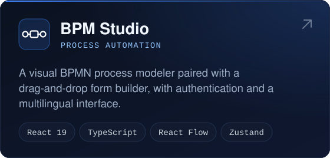
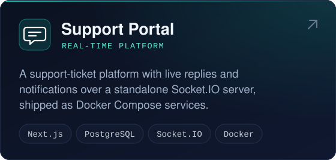
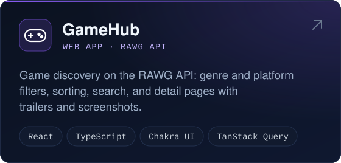
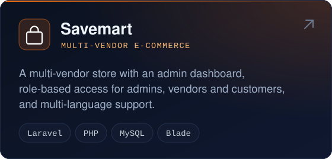
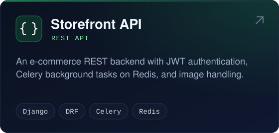
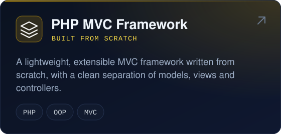
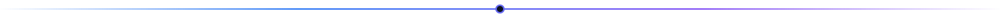

  

  
  
  

## About

I'm a full-stack software engineer at **CTC MENA**, where I build enterprise web platforms for content and document management, business-process automation, and meetings management.

I specialise in **React and TypeScript** on the front end and work across **ASP.NET Core, Laravel and Django** on the back end. I care about maintainable architecture, responsive real-time experiences, and interfaces that work equally well in **English and Arabic (RTL)**.

## Core Expertise

<table>
  <tr>
    <td width="50%" valign="top">
      <h4>Frontend Engineering</h4>
      <ul>
        <li>React and TypeScript application architecture</li>
        <li>State and server data with Zustand and TanStack Query</li>
        <li>Design systems with Tailwind CSS</li>
        <li>Internationalisation and right-to-left layouts</li>
      </ul>
    </td>
    <td width="50%" valign="top">
      <h4>Backend &amp; APIs</h4>
      <ul>
        <li>REST APIs with C# and ASP.NET Core</li>
        <li>Laravel and PHP applications</li>
        <li>Django and Django REST Framework</li>
        <li>PostgreSQL, MySQL and Redis</li>
      </ul>
    </td>
  </tr>
  <tr>
    <td width="50%" valign="top">
      <h4>Enterprise Platforms</h4>
      <ul>
        <li>Content and document management systems</li>
        <li>BPMN workflow modeling and form builders</li>
        <li>Real-time notifications with SignalR and Socket.IO</li>
        <li>Role-based access control</li>
      </ul>
    </td>
    <td width="50%" valign="top">
      <h4>Engineering Practice</h4>
      <ul>
        <li>Component-driven, modular codebases</li>
        <li>Unit and integration testing with Vitest</li>
        <li>Containerised environments with Docker</li>
        <li>Git workflows and code review</li>
      </ul>
    </td>
  </tr>
</table>

## Technologies

<table>
  <tr>
    <td align="center" width="130"><b>Languages</b></td>
    <td></td>
  </tr>
  <tr>
    <td align="center"><b>Frontend</b></td>
    <td></td>
  </tr>
  <tr>
    <td align="center"><b>Backend</b></td>
    <td></td>
  </tr>
  <tr>
    <td align="center"><b>Data</b></td>
    <td></td>
  </tr>
  <tr>
    <td align="center"><b>Tooling</b></td>
    <td></td>
  </tr>
  <tr>
    <td align="center"><b>Libraries</b></td>
    <td>
      
      
      
      
      
      
      
      
      
      
      
      
    </td>
  </tr>
</table>

## Featured Projects

  
  

  
  

  
  

## GitHub Analytics

  

## Get in Touch

I'm always open to conversations about engineering, enterprise platforms and collaboration. The quickest way to reach me is on [LinkedIn](https://www.linkedin.com/in/mostafa-allam-aa9a9023b) or by [email](mailto:mostafaallam602@gmail.com).

  

